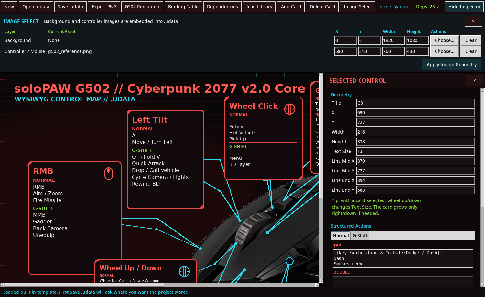

# 🐾 soloPAW

> **One mouse. Dense controls. Less reach.**


**soloPAW** is a Linux mouse-first control project for players who want a gaming mouse to behave like a compact controller surface: one-handed play, reduced keyboard reaching, accessibility-oriented layouts, fast game swapping, high-density bindings, and visual control-map authoring.

It started around the Logitech G502 because its thumb cluster, top buttons, wheel click, wheel tilt, primary buttons, and free-spin wheel make a strong set of **physically distinct** inputs for layered controls. The same ideas can be adapted to other mice.

> soloPAW is an independent community project. It is not affiliated with or endorsed by Logitech, CD PROJEKT RED, Megabonk's developers/publisher, Krita, or Input Remapper.

---

## 🎮 The headline: ~76% of a reviewed Cyberpunk control set on one mouse

The reference audit spans 87 visible binding rows across Exploration & Combat, driving/Panzer, BrainDance, and UI. The v2.5 audit reached **65/87 = 74.7%**. The current v2.8 arrangement preserves that covered set and adds Main Menu through contextual `L`, for **66/87 = 75.9% under the same methodology**.

This is an auditable reference count rather than a claim about every possible action or future game version. See [the current profile guide](docs/CYBERPUNK2077_PROFILE.md) and [the original audit](docs/CYBERPUNK_REFERENCE_AUDIT_v2.5.md).

The mappings were iterated around real control conflicts:

- preserving native/free-spin vertical wheel behavior;
- lowering Dash's classifier to **225 ms**;
- dropping unreliable double-tap wheel-tilt gestures;
- moving Scan away from a forced UI navigation key;
- making minigame `J` reachable by the thumb;
- keeping direct press/hold behavior for games that need it;
- preserving accepted profiles as rollback instead of overwriting them.

---

## 🧰 What's in this repository

| Component | Version | Purpose |
|---|---:|---|
| **soloPAW Profile Switcher** | **v0.2.1** | Stream-safe Input Remapper browser/switcher with aliases, three quick presets, auto-reload, import/export, privacy checks, and service diagnostics |
| **soloPAW Controller Map Studio** | **v0.1.0-rc.1** | Linux-native WYSIWYG controller-map authoring, `.udata`, PNG/export bundles, binding tables, Input Remapper export, embedded assets, and desktop integration |
| **Cyberpunk 2077 profile** | **v2.8** | Dense G502 Normal/G-Shift tap-double-hold profile |
| **Megabonk profile** | **v1.1** | Direct-key map for ordinary press/release and sustained holds |

```text
soloPAW/
├── apps/
│   ├── profile-switcher/
│   └── controller-map-studio/
├── profiles/
│   ├── cyberpunk2077/
│   └── megabonk/
├── docs/
├── scripts/
└── README.md
```

---

## ⚡ Profile Switcher

```text
┌──────────────────────────────────────────────────────────────────┐
│ [ Cyberpunk ]          [ Megabonk ]           [ Editing / Krita ]│
├───────────────────────────────┬──────────────────────────────────┤
│ Available Profiles            │ Current State                    │
│ Cyberpunk — v2.8              │ ACTIVE NOW: Cyberpunk — v2.8     │
│ Megabonk — Direct Keys        │ AUTO-RELOAD: Cyberpunk — v2.8    │
│ Editing                       │                                  │
│ [Activate] [Auto-Reload]      │ [Service Doctor]                 │
│ [Import] [Public Export]      │                                  │
└───────────────────────────────┴──────────────────────────────────┘
```

The main display is designed for livestream use: Common Names can hide long filenames, and full home paths/usernames are not shown. File-manager/file-picker operations are marked as off-stream actions.

```bash
cd apps/profile-switcher
./setup_dependencies.sh
./install.sh
solopaw-profile-switcher
```

---

## 🗺️ Controller Map Studio



The Studio turns a dense mapping into something readable, editable, and shareable. `.udata` projects can carry card geometry, connectors, Normal/G-Shift Tap/Double/Hold content, embedded assets, Cyberpunk binding tables, and Input Remapper mappings.

```bash
cd apps/controller-map-studio
./setup_cachyos.sh
./verify_release.sh
./install_desktop.sh
solopaw-controller-map-studio
```

The Studio source here is the **v0.1.0-rc.1 release-sealed build** and retains its verifier/checksums.

---

## 🐭 Why not just use a mouse with a full side numpad?

A full MMO/numpad mouse can be excellent when raw shortcut count is the priority—coding and editing are obvious examples. soloPAW's gameplay design favors **fewer but more spatially distinct controls**, with context and a shift layer multiplying them.

The G502 layout makes thumb buttons, top buttons, wheel click, left/right wheel tilt, primary clicks, and wheel directions identifiable by physical location while still achieving high action density.

See [Design Philosophy](docs/DESIGN_PHILOSOPHY.md).

---

## ♿ Mouse-first and one-hand play

soloPAW is for anyone who benefits from moving more game actions onto the mouse: one-handed players, people reducing keyboard reach, accessibility experiments, streamers, or players who simply prefer advanced mouse controls.

No single layout fits everyone. The tools exist so users can adapt the concept to their own reach, timing, game, and hardware.

---

## 📦 Current public profiles

### Cyberpunk 2077

[`soloPAW-Cyberpunk2077-v2.8-JDirect-ScanH-QuickW.json`](profiles/cyberpunk2077/soloPAW-Cyberpunk2077-v2.8-JDirect-ScanH-QuickW.json)

Highlights: G5=`J`, G8 tap=Left Ctrl/Dash at 225 ms, G6+G8=`H` Scan/Analysis, G6+Wheel Click=`L` Main Menu/BD Layer, G6+G9 hold=`W` Quicksave, native Wheel Up/Down, and no double-tap tilt actions.

See [CYBERPUNK2077_PROFILE.md](docs/CYBERPUNK2077_PROFILE.md).

### Megabonk

[`soloPAW-Megabonk-v1.1-DirectKeys-Esc.json`](profiles/megabonk/soloPAW-Megabonk-v1.1-DirectKeys-Esc.json)

A deliberately simpler direct-key profile for controls that need ordinary physical press/release behavior.

---

## 🔒 Privacy / streaming

Before sharing publicly:

```bash
./scripts/doctor.sh
```

Do not upload your home directory, Input Remapper journals, shell history, `.gitconfig`, token files, or raw desktop screenshots without reviewing them. See [PRIVACY.md](docs/PRIVACY.md).

---

## 🚀 Put soloPAW on GitHub

Recommended terminal authentication:

```bash
sudo pacman -S --needed git github-cli
gh auth login --web --git-protocol https
gh auth status
```

Then from this repository root:

```bash
git init -b main
git add .
git status
git commit -m "Initial soloPAW public release"
gh repo create soloPAW --public --source=. --remote=origin --push
```

Read [GITHUB_AUTH_AND_UPLOAD.md](docs/GITHUB_AUTH_AND_UPLOAD.md) first, especially if you want a fine-grained personal access token instead.

---

## ✅ Verify / package

```bash
./scripts/doctor.sh
./scripts/package_release.sh
```

`dist/` is gitignored so release archives do not clutter source history.

---

## 🤝 Contributions

See [CONTRIBUTING.md](CONTRIBUTING.md). Profile contributions should document hardware, OS, Input Remapper version, game/app, required in-game binding changes, and real runtime testing.

---

## 📜 License and trademarks

A project license has **not been selected on the user's behalf**. Choose one before inviting outside reuse/contributions; see [LICENSE_OPTIONS.md](LICENSE_OPTIONS.md).

Logitech, G502, Cyberpunk 2077, CD PROJEKT RED, Megabonk, Krita, and other product names belong to their respective owners. Names are used only for compatibility/reference. No affiliation or endorsement is implied.
